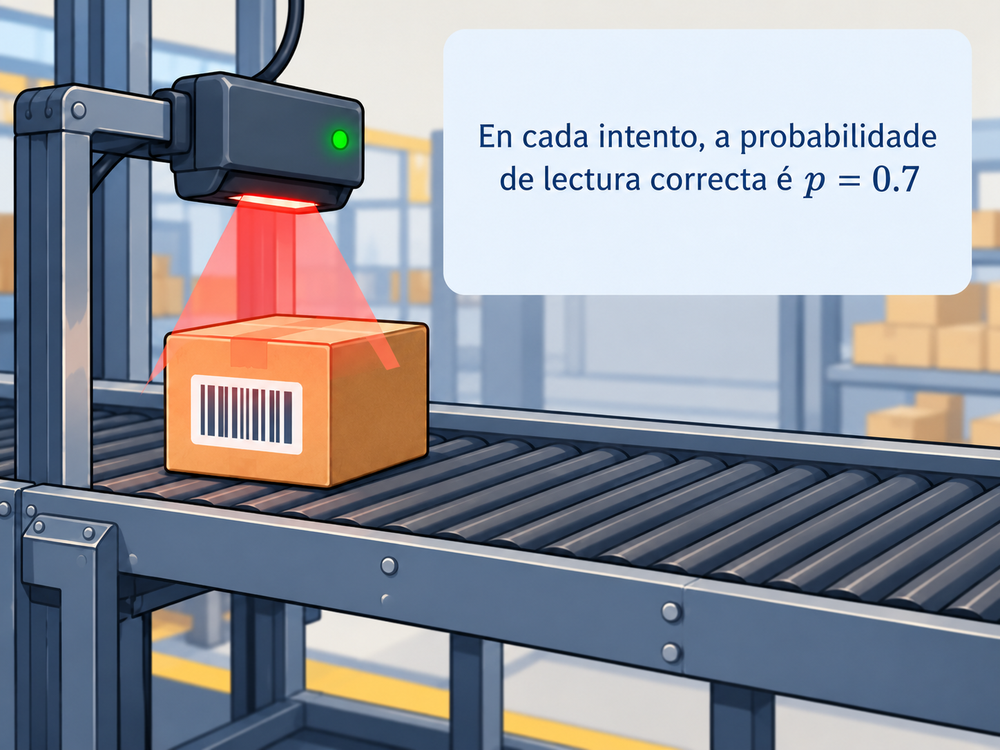
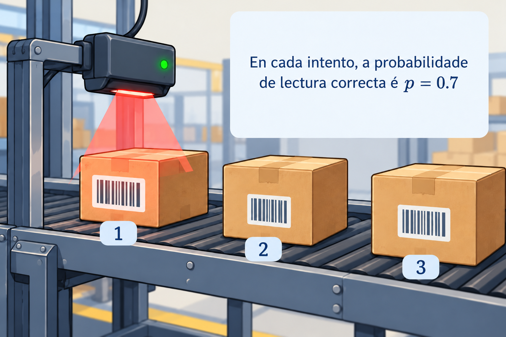
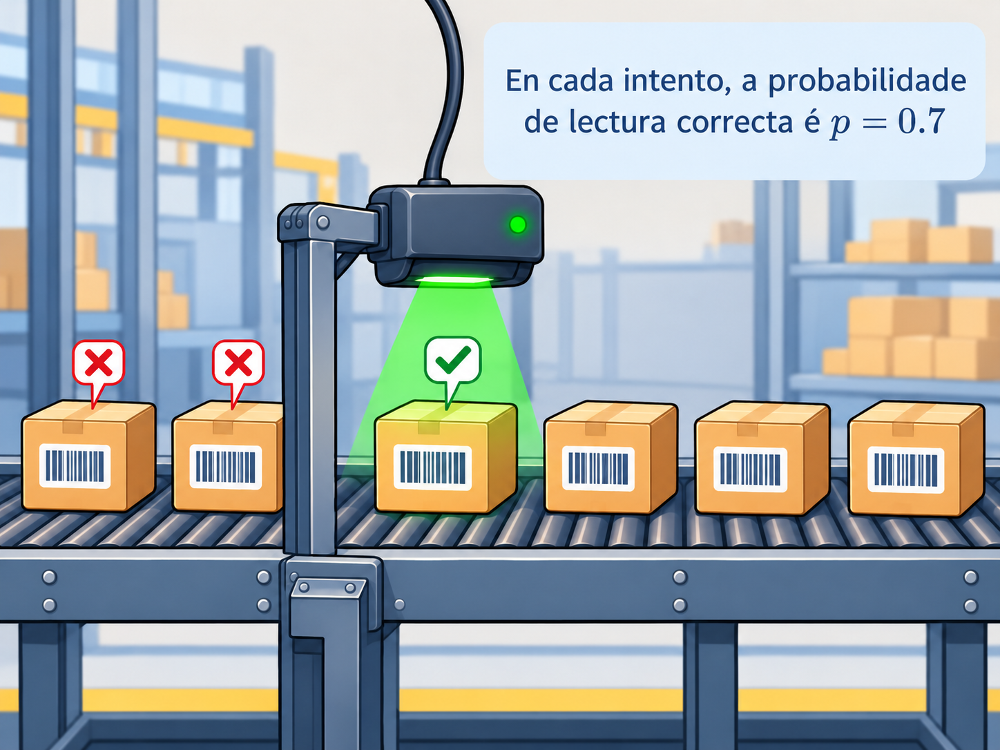
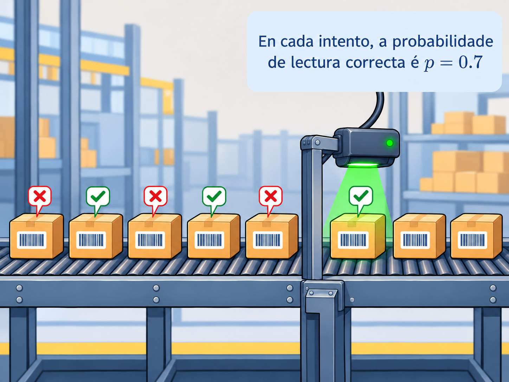
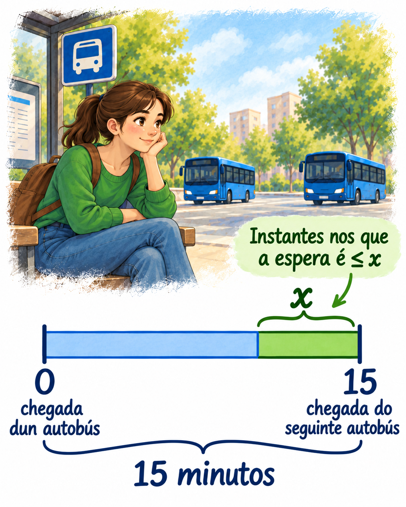

## Tema 5. Principais modelos de probabilidade
```{r}
library(tidyverse)
library(kableExtra)
```
<style>
.mysmall {
  font-size: 0.85em;
}
</style>

Ao rematar este tema deberías:

::: {.columns}

::: {.column width="25%"}
{}
:::

::: {.column width="70%"}
<br>


- [ ] Coñecer os principais modelos de probabilidade discretos, saber como se definen e cales son as súas características principais
- [ ] Coñecer os principais modelos de probabilidade continuos, saber como se definen e cales son as súas características principais
- [ ] Coñecer o Teorema Central do Límite
- [ ] Saber realizar aproximacións entre variables aleatorias
:::
:::


## Principais modelos de variables aleatorias discretas


::: {.callout-note icon=false}
## Distribución de Bernoulli

En moitas ocasións atopámonos ante experimentos aleatorios con só dous posibles resultados: Éxito e fracaso. Sexa $p$ a probabilidade de éxito. Poden modelarse estas situacións mediante a variable aleatoria
$$X=\left\{\begin{array}{ll}1&\textnormal{se Éxito}\\
0&\textnormal{se Fracaso}\end{array}\right.$$
Así definida, $X$ ten distribución de Bernoulli de parámetro $p$
 e denotamos $X \sim \textnormal{Bernoulli}(p)$. 
:::

::: panel-tabset
### Exemplo 
::: {.columns}

::: {.column width="30%"}
{height="100%" fig-align="center"}
:::

::: {.column width="70%"}
::: {.mysmall}
Un lector automático intenta ler o código de barras dun paquete que por unha cinta. En cada intento, a probabilidade de que o código se lea correctamente é $p=0.7$. Sexa

$$X=\begin{cases}1,&\text{se a lectura é correcta},\\0,&\text{se é incorrecta}.\end{cases}$$


Así definida, $X \sim \textnormal{Bernoulli}(p=0.7)$
:::
:::
:::
:::

## Principais modelos de variables aleatorias discretas


::: {.callout-note icon=false}
## Distribución de Bernoulli

En moitas ocasións atopámonos ante experimentos aleatorios con só dous posibles resultados: Éxito e fracaso. Sexa $p$ a probabilidade de éxito. Poden modelarse estas situacións mediante a variable aleatoria
$$X=\left\{\begin{array}{ll}1&\textnormal{se Éxito}\\
0&\textnormal{se Fracaso}\end{array}\right.$$
Así definida, $X$ ten distribución de Bernoulli de parámetro $p$
 e denotamos $X \sim \textnormal{Bernoulli}(p)$. 
::: 


::: panel-tabset
### $\textnormal{Bernoulli}(p)$

::: {.columns}

::: {.column width="70%"}
::: {.callout-tip icon=false}
## Función de masa
$$
\begin{aligned}
p(0)={P}(X=0)&=1-p \\
p(1)={P}(X=1)&=p 
\end{aligned}
$$
:::
:::

::: {.column width="30%"}
::: {.callout-tip icon=false}
## Características:

- $\mathbb{E}(X) = p$
- $\mathrm{Var}(X) = p(1 - p)$
:::
::: 
:::


:::


## Principais modelos de variables aleatorias discretas

::: {.callout-tip icon=false}
## Distribución de Bernoulli — Exemplos resoltos

::: {.mysmall}
Co lector de códigos de barras, $X\sim\textnormal{Bernoulli}(0.7)$:

- **Cal é a probabilidade de que a lectura sexa correcta?** $P(X=1)=0.7$.
- **Cal é a probabilidade de que a lectura sexa incorrecta?** $P(X=0)=1-0.7=0.3$.
- **Cales son a esperanza e a varianza de $X$?** $E(X)=0.7$ e $\operatorname{Var}(X)=0.7\cdot0.3=0.21$.
:::
:::


## Principais modelos de variables aleatorias discretas


::: {.callout-note icon=false}
## Distribución binomial
Consideramos o experimento que consiste en repetir $n$ veces un experimento de Bernoulli. Sexa
$$X=\text{número de éxitos en } n \text{ experimentos independentes de Bernoulli de parámetro } p.$$
Así definida, $X$ ten distribución binomial de parámetros $n$ e $p$ e denotamos $X\sim\text{Binom}(n, p)$.


:::


::: panel-tabset
### Exemplo 
::: {.columns}

::: {.column width="30%"}
{height="100%" fig-align="center"}
:::

::: {.column width="70%"}
::: {.mysmall}
Un lector automático intenta ler o código de barras dos paquetes que pasan por unha cinta. En cada intento, a probabilidade de que o código se lea correctamente é $p=0.7$, e a lectura dun paquete é independente das demais.
O lector intenta ler o código de 3 paquetes. 

Sexa $X=\text{Número de lecturas correctas nos tres intentos}.$

Así definida, $X \sim \text{Binom}(n=3, p=0.7)$

:::
:::
:::
:::


## Principais modelos de variables aleatorias discretas


::: {.callout-note icon=false}
## Distribución binomial
Consideramos o experimento que consiste en repetir $n$ veces un experimento de Bernoulli. Sexa
$$X=\text{número de éxitos en } n \text{ experimentos independentes de Bernoulli de parámetro } p.$$
Así definida, $X$ ten distribución binomial de parámetros $n$ e $p$ e denotamos $X\sim\text{Binom}(n, p)$.


::: 


::: panel-tabset
### $\textnormal{Binom}(n,p)$

::: {.columns}

::: {.column width="70%"}
::: {.callout-tip icon=false}
## Función de masa
$$
P(X = x) = \binom{n}{x} p^x (1 - p)^{n - x},\quad x = 0,1,\ldots,n.
$$
:::
:::

::: {.column width="30%"}
::: {.callout-tip icon=false}
## Características:

-  $\mathbb{E}(X) = np$
-  $\mathrm{Var}(X) = np(1 - p)$

:::
::: 
:::


### Representacións gráficas
```{r}
#| echo: false
#| fig-height: 2.8
#| fig-width: 10
#| fig.align: "center"
library(ggplot2)
library(gridExtra)

# Función que crea o data.frame para unha Binomial
binom_df <- function(n, p) {
  x <- 0:n
  px <- dbinom(x, n, p)
  data.frame(x = x, px = px, n = n, p = p)
}

# 4 binomiais distintas
d1 <- binom_df(3, 0.3)
d2 <- binom_df(3, 0.7)
d3 <- binom_df(5, 0.5)
d4 <- binom_df(8, 0.4)

# Función para facer o gráfico de barras (tipo "h")
make_plot <- function(df) {
  n <- unique(df$n)
  p <- unique(df$p)
  
  ggplot(df, aes(x = x, y = px)) +
    geom_segment(aes(x = x, xend = x, y = 0, yend = px), size = 1) +
    geom_point(size = 2) +
    scale_y_continuous(limits = c(0, 0.45)) +
    labs(
      title = paste0("Binom(", n, ", ", p, ")"),
      x = "x",
      y = "P(X=x)"
    ) +
    theme_minimal() +
    theme(
      plot.title = element_text(hjust = 0.5, size = 10),
      axis.text = element_text(size = 8),
      axis.title = element_text(size = 9)
    )
}

p1 <- make_plot(d1)
p2 <- make_plot(d2)
p3 <- make_plot(d3)
p4 <- make_plot(d4)

# Panel 2x2
grid.arrange(p1, p2, p3, p4, nrow = 1)

```


### Código R
```{r}
#| eval: true
#| tidy: true
#| echo: true
#| output: false
#| collapse: true
n<-3   # Número de intentos
p<-0.7 # Probabilidade de éxito de cada intento
x<-0:n # Valores que toma a variable
px<-dbinom(x,n,p)   # Función de masa dunha Binom(n,p) avaliada en x
plot(x, px, type = "h", xlab = "x", ylab = "P(X=x)") # Representación da función de masa
```

:::


## Principais modelos de variables aleatorias discretas

::: {.callout-tip icon=false}
## Distribución binomial — Exemplos resoltos

::: {.mysmall}
Para as 3 lecturas independentes, $X\sim\text{Binom}(3,0.7)$:

- **Cal é a probabilidade de obter exactamente 2 lecturas correctas?** $P(X=2)=\binom{3}{2}(0.7)^2(0.3)=0.441$.
- **Cal é a probabilidade de obter polo menos 2 correctas?** $P(X\geq2)=P(X=2)+P(X=3)=0.784$.
- **Cal é a probabilidade de obter como máximo 1 correcta?** $P(X\leq1)=0.216$.
:::
:::


## Principais modelos de variables aleatorias discretas


::: {.callout-note icon=false}
## Distribución xeométrica

Consideramos o experimento que consiste en repetir un experimento de Bernoulli  ata obter o primeiro éxito. Sexa $p$ probabilidade de éxito en cada intento e 
$$X=\text{número de fracasos antes de obter o primeiro éxito}$$
Así definida, $X$ ten distribución xeométrica de parámetro $p$ e denotamos $X \sim \textnormal{Xe}(p)$.


:::


::: panel-tabset
### Exemplo 
::: {.columns}

::: {.column width="30%"}
{height="100%" fig-align="center"}
:::

::: {.column width="70%"}
::: {.mysmall}
Un lector automático intenta ler o código de barras dos paquetes que pasan por unha cinta. En cada intento, a probabilidade de que o código se lea correctamente é $p=0.7$, e a lectura dun paquete é independente das demais.


Sexa $X=\text{Número de lecturas incorrectas antes da primeira lectura correcta}.$

Así definida, $X\sim \textnormal{Xe}(p=0.7)$.
:::
:::
:::
:::


## Principais modelos de variables aleatorias discretas


::: {.callout-note icon=false}
## Distribución xeométrica

Consideramos o experimento que consiste en repetir un experimento de Bernoulli  ata obter o primeiro éxito. Sexa $p$ probabilidade de éxito en cada intento e 
$$X=\text{número de fracasos antes de obter o primeiro éxito}$$
Así definida, $X$ ten distribución xeométrica de parámetro $p$ e denotamos $X \sim \textnormal{Xe}(p)$.


::: 


::: panel-tabset
### $\textnormal{Xe}(p)$

::: {.columns}

::: {.column width="70%"}
::: {.callout-tip icon=false}
## Función de masa
$$
P(X = x) = (1 - p)^x p, \quad x = 0, 1, 2, \ldots
$$
:::
:::

::: {.column width="30%"}
::: {.callout-tip icon=false}
## Características:

-  $\mathbb{E}(X) = \dfrac{1 - p}{p}$
- $\mathrm{Var}(X) = \dfrac{1 - p}{p^2}$
:::
::: 
:::


### Representacións gráficas
```{r}
#| echo: false
#| fig-height: 2.6
#| fig-width: 8
#| fig.align: "center"
library(ggplot2)
library(gridExtra)

# Función que crea o data.frame para unha Xeométrica (primeros 10 valores)
geom_df <- function(p, max_x = 10) {
  x <- 0:max_x
  px <- dgeom(x, prob = p)
  data.frame(x = x, px = px, p = p)
}

# 3 xeométricas distintas
d1 <- geom_df(0.2)
d2 <- geom_df(0.5)
d3 <- geom_df(0.7)

# Función para facer o gráfico de barras (tipo "h")
make_plot <- function(df) {
  p <- unique(df$p)
  
  ggplot(df, aes(x = x, y = px)) +
    geom_segment(aes(x = x, xend = x, y = 0, yend = px), size = 1) +
    geom_point(size = 2) +    
    scale_x_continuous(breaks = unique(df$x)) +
     scale_y_continuous(limits = c(0, 0.7)) +
    labs(
      title = paste0("Xe(p=", p, ")"),
      x = "x",
      y = "P(X=x)"
    ) +
    theme_minimal() +
    theme(
      plot.title = element_text(hjust = 0.5, size = 10),
      axis.text = element_text(size = 8),
      axis.title = element_text(size = 9)
    )
}

p1 <- make_plot(d1)
p2 <- make_plot(d2)
p3 <- make_plot(d3)

# Panel 1x3
grid.arrange(p1, p2, p3, nrow = 1)


```


### Código R
```{r}
#| eval: true
#| tidy: true
#| echo: true
#| output: false
#| collapse: true
p <- 0.7              # Probabilidade de éxito en cada intento
x <- 0:20            # Valores da variable
px <- dgeom(x, prob = p)   # Función de masa dunha Xe(p) avaliada en x
plot(x, px, type = "h", xlab = "x", ylab = "P(X=x)")
```

:::


## Principais modelos de variables aleatorias discretas

::: {.callout-tip icon=false}
## Distribución xeométrica — Exemplos resoltos

::: {.mysmall}
$X$ conta as lecturas incorrectas antes da primeira correcta; $X\sim\textnormal{Xe}(0.7)$:

- **Cal é a probabilidade de acertar á primeira?** $P(X=0)=0.7$.
- **Cal é a probabilidade de ter 2 erros antes do primeiro acerto?** $P(X=2)=(0.3)^2(0.7)=0.063$.
- **Cal é a probabilidade de necesitar máis de 3 intentos?** $P(X\geq3)=(0.3)^3=0.027$.
:::
:::


## Principais modelos de variables aleatorias discretas


::: {.callout-note icon=false}
## Distribución binomial negativa

Consideramos o experimento que consiste en repetir un experimento de Bernoulli  ata obter o $k$-ésimo éxito. Sexa $p$ probabilidade de éxito en cada intento e 
$$X=\text{número de fracasos antes de acadar o } k\text{-ésimo éxito}$$
Así definida, $X$ ten distribución binomial negativa de parámetros $k$ e $p$ e denotamos $X \sim \textnormal{BN}(k, p)$
:::

::: panel-tabset
### Exemplo 
::: {.columns}

::: {.column width="30%"}
{height="100%" fig-align="center"}
:::

::: {.column width="70%"}
::: {.mysmall}
Un lector automático intenta ler o código de barras dos paquetes que pasan por unha cinta. En cada intento, a probabilidade de que o código se lea correctamente é $p=0.7$, e a lectura dun paquete é independente das demais.


Sexa $X=\text{Número de lecturas incorrectas antes da terceira lectura correcta}.$


Así definida, $X\sim \textnormal{BN}(k=3, p=0.7)$.
:::
:::
:::
:::


## Principais modelos de variables aleatorias discretas


::: {.callout-note icon=false}
## Distribución binomial negativa

Consideramos o experimento que consiste en repetir un experimento de Bernoulli  ata obter o $k$-ésimo éxito. Sexa $p$ probabilidade de éxito en cada intento e 
$$X=\text{número de fracasos antes de acadar o } k\text{-ésimo éxito}$$
Así definida, $X$ ten distribución binomial negativa de parámetros $k$ e $p$ e denotamos $X \sim \textnormal{BN}(k, p)$
::: 


::: panel-tabset
### $\textnormal{BN}(k,p)$

::: {.columns}

::: {.column width="70%"}
::: {.callout-tip icon=false}
## Función de masa
$$
P(X = x) = \binom{k + x - 1}{x} p^k (1 - p)^x, \quad x = 0, 1, 2, \ldots
$$
:::
:::

::: {.column width="30%"}
::: {.callout-tip icon=false}
## Características:

-  $\mathbb{E}(X) = \dfrac{k(1 - p)}{p}$
- $\mathrm{Var}(X) = \dfrac{k(1 - p)}{p^2}$
:::
::: 
:::


### Representacións gráficas
```{r}
#| echo: false
#| fig-height: 2.6
#| fig-width: 8
#| fig.align: "center"
library(ggplot2)
library(gridExtra)

# Función que crea o data.frame para unha Binomial negativa (primeiros 15 valores)
nbinom_df <- function(r, p, max_x = 15) {
  x <- 0:max_x
  px <- dnbinom(x, size = r, prob = p)
  data.frame(x = x, px = px, r = r, p = p)
}

# 3 binomiais negativas distintas (fixamos r=3)
d1 <- nbinom_df(r = 3, p = 0.3,max_x = 30)
d2 <- nbinom_df(r = 3, p = 0.5,max_x = 30)
d3 <- nbinom_df(r = 3, p = 0.7,max_x = 30)

# Función para facer o gráfico de barras (tipo "h")
make_plot <- function(df) {
  r <- unique(df$r)
  p <- unique(df$p)
  
  ggplot(df, aes(x = x, y = px)) +
    geom_segment(aes(x = x, xend = x, y = 0, yend = px), size = 1) +
    geom_point(size = 2) +
     scale_y_continuous(limits = c(0, 0.3)) +
    labs(
      title = paste0("BN(k=", r, ", p=", p, ")"),
      x = "x",
      y = "P(X=x)"
    ) +
    theme_minimal() +
    theme(
      plot.title = element_text(hjust = 0.5, size = 10),
      axis.text = element_text(size = 8),
      axis.title = element_text(size = 9)
    )
}

p1 <- make_plot(d1)
p2 <- make_plot(d2)
p3 <- make_plot(d3)

# Panel 1x3
grid.arrange(p1, p2, p3, nrow = 1)


```


### Código R
```{r}
#| eval: true
#| tidy: true
#| echo: true
#| output: false
#| collapse: true
k<- 3  
p <- 0.7              # Probabilidade de éxito en cada intento
x <- 0:30            # Valores da variable
px <- dnbinom(x, size=k,prob = p)   # Función de masa dunha BN(k,p) avaliada en x
plot(x, px, type = "h", xlab = "x", ylab = "P(X=x)")
```

:::


## Principais modelos de variables aleatorias discretas

::: {.callout-tip icon=false}
## Distribución binomial negativa — Exemplos resoltos

::: {.mysmall}
$X$ conta os erros antes da terceira lectura correcta; $X\sim\textnormal{BN}(3,0.7)$:

- **Cal é a probabilidade de non cometer erros antes da terceira lectura correcta?** $P(X=0)=(0.7)^3=0.343$.
- **Cal é a probabilidade de cometer exactamente 2 erros?** $P(X=2)=\binom{4}{2}(0.7)^3(0.3)^2=0.18522$.
- **Cal é a probabilidade de cometer como máximo 2 erros?** $P(X\leq2)=0.83692$.
:::
:::


## Principais modelos de variables aleatorias discretas


::: {.callout-note icon=false}
## Distribución de Poisson

Un proceso de Poisson consiste en observar o número de veces que se presenta un suceso nun determinado intervalo (de tempo, espazo, ...). Supónse que os sucesos ocorren de maneira aleatoria pero cunha taxa media constante. Sexa $\lambda > 0$ o número medio de sucesos no intervalo e
$$X=\text{número de éxitos por intervalo}$$
Así definida $X$ ten distribución de Poisson de parámetro $\lambda$ e denotamos $X \sim \text{Pois}(\lambda)$.
:::

::: panel-tabset
### Exemplo 
::: {.columns}

::: {.column width="30%"}
{height="100%" fig-align="center"}
:::

::: {.column width="70%"}
::: {.mysmall}
Nun centro loxístico recíbense pedidos de maneira aleatoria e independente, cunha taxa media constante de $\lambda=6$ pedidos por hora.

Sexa $X=\text{número de pedidos recibidos nunha hora}$.


Así definida, $X\sim \text{Pois}(\lambda=6)$.

:::
:::
:::
:::

## Principais modelos de variables aleatorias discretas


::: {.callout-note icon=false}
## Distribución de Poisson

Un proceso de Poisson consiste en observar o número de veces que se presenta un suceso nun determinado intervalo (de tempo, espazo, ...). Supónse que os sucesos ocorren de maneira aleatoria pero cunha taxa media constante. Sexa $\lambda > 0$ o número medio de sucesos no intervalo e
$$X=\text{número de éxitos por intervalo}$$
Así definida $X$ ten distribución de Poisson de parámetro $\lambda$ e denotamos $X \sim \text{Pois}(\lambda)$.
::: 


::: panel-tabset
### $\textnormal{Pois}(\lambda)$

::: {.columns}

::: {.column width="70%"}
::: {.callout-tip icon=false}
## Función de masa
$$
P(X = x) = \frac{e^{-\lambda} \lambda^x}{x!}, \quad x = 0, 1, 2, \ldots
$$
:::
:::

::: {.column width="30%"}
::: {.callout-tip icon=false}
## Características:

-  $\mathbb{E}(X) = \lambda$
- $\mathrm{Var}(X) = \lambda$
:::
::: 
:::


### Representacións gráficas
```{r}
#| echo: false
#| fig-height: 2.4
#| fig-width: 8
#| fig.align: "center"
library(ggplot2)
library(gridExtra)

# Función que crea o data.frame para unha Poisson (primeiros 30 valores)
pois_df <- function(lambda, max_x = 30) {
  x <- 0:max_x
  px <- dpois(x, lambda = lambda)
  data.frame(x = x, px = px, lambda = lambda)
}

# 3 Poisson distintas
d1 <- pois_df(lambda = 0.4, max_x = 20)
d2 <- pois_df(lambda = 1, max_x = 20)
d3 <- pois_df(lambda = 4, max_x = 20)
d4 <- pois_df(lambda = 6, max_x = 20)

# Función para facer o gráfico de barras (tipo "h")
make_plot <- function(df) {
  lambda <- unique(df$lambda)
  
  ggplot(df, aes(x = x, y = px)) +
    geom_segment(aes(x = x, xend = x, y = 0, yend = px), size = 1) +
    geom_point(size = 2) +
     scale_y_continuous(limits = c(0, 0.7)) +
    labs(
      title = paste0("Pois(λ=", lambda, ")"),
      x = "x",
      y = "P(X=x)"
    ) +
    theme_minimal() +
    theme(
      plot.title = element_text(hjust = 0.5, size = 10),
      axis.text = element_text(size = 8),
      axis.title = element_text(size = 9)
    )
}

p1 <- make_plot(d1)
p2 <- make_plot(d2)
p3 <- make_plot(d3)
p4 <- make_plot(d4)
# Panel 1x3
grid.arrange(p1, p2, p3, p4, nrow = 1)


```


### Código R
```{r}
#| eval: true
#| tidy: true
#| echo: true
#| output: false
#| collapse: true
lambda<- 6  
x <- 0:20            # Valores da variable
px <- dpois(x,lambda=lambda)   # Función de masa dunha Pois(lambda) avaliada en x
plot(x, px, type = "h", xlab = "x", ylab = "P(X=x)")
```

:::


## Principais modelos de variables aleatorias discretas
::: {.callout-tip icon=false}
## Distribución de Poisson — Exemplos resoltos

::: {.mysmall}
Nun centro loxístico recíbense pedidos cunha taxa media de
$\lambda=6$ pedidos por hora. Sexa $X\sim\text{Pois}(6)$ o número de pedidos recibidos nunha hora.

- **Cal é a probabilidade de recibir exactamente 4 pedidos nunha hora?** $P(X=4)=e^{-6}\frac{6^4}{4!}\approx 0.1339$

- **Cal é a probabilidade de recibir como máximo 3 pedidos nunha hora?**  $P(X\leq 3)=\sum_{x=0}^{3}e^{-6}\frac{6^x}{x!}\approx 0.1512$

- **Cal é a probabilidade de recibir exactamente 2 pedidos en 10 minutos?**   Para un intervalo de 10 minutos, o parámetro é $\lambda_{10}=6\cdot\frac{10}{60}=1
  $.  Se $Y$ é o número de pedidos recibidos en 10 minutos,
  entón $Y\sim\text{Pois}(1)$ e $P(Y=2)=e^{-1}\frac{1^2}{2!}\approx 0.1839$

:::
:::


## Principais modelos de variables aleatorias discretas


::: {.callout-note icon=false}
## Distribución hiperxeométrica

Consideremos unha poboación finita de $N$ elementos, dos cales $k$ pertencen á clase $D$  e $N-k$ ao resto. Tomamos unha mostra **sen reposición** de tamaño $n$ e estudamos a variable aleatoria 
$$X=\text{número de elementos da clase }D\text{ na mostra de tamaño }n$$
Así definida, $X$ ten distribución hiperxeométrica de parámetros $N$, $n$ e $k$ e denotamos  $X \sim \text{H}(N, n, k)$
:::

::: panel-tabset
### Exemplo 
::: {.columns}

::: {.column width="30%"}
{height="100%" fig-align="center"}
:::

::: {.column width="70%"}
::: {.mysmall}
Nun lote de $N=100$ paquetes, $k=20$ son fráxiles. Seleccionamos ao azar $n=10$ paquetes sen reposición.

Sexa $X=\text{número de paquetes fráxiles na mostra}$.


Así definida, $X \sim \text{H}(N=100, n=10, k=20)$
:::
:::
:::
:::

## Principais modelos de variables aleatorias discretas


::: {.callout-note icon=false}
## Distribución hiperxeométrica

Consideremos unha poboación finita de $N$ elementos, dos cales $k$ pertencen á clase $D$  e $N-k$ ao resto. Tomamos unha mostra **sen reposición** de tamaño $n$ e estudamos a variable aleatoria 
$$X=\text{número de elementos da clase }D\text{ na mostra de tamaño }n$$
Así definida, $X$ ten distribución hiperxeométrica de parámetros $N$, $n$ e $k$ e denotamos  $X \sim \text{H}(N, n, k)$
::: 


::: panel-tabset
### $\text{H}(N, n, k)$

::: {.columns}

::: {.column width="70%"}
::: {.callout-tip icon=false}
## Función de masa
$$
P(X = x) = \frac{\binom{k}{x}  \binom{N-k}{n - x}}{\binom{N}{n}}, \quad \max\{0, n - (N - k)\} \le x \le \min\{k, n\}.
$$
:::
:::

::: {.column width="30%"}
::: {.callout-tip icon=false}
## Características:
Sexa $p = \frac{k}{N}$.

-  $\mathbb{E}(X) = n p$
- $\mathrm{Var}(X) = \frac{n p (1 - p) (N - n)}{N - 1}$
:::
::: 
:::


### Representacións gráficas
```{r}
#| echo: false
#| fig-height: 2.4
#| fig-width: 8
#| fig.align: "center"
library(ggplot2)
library(gridExtra)

# Función que crea o data.frame para unha Hiperxeométrica
hyper_df <- function(m, n, k) {
  x <- max(0, k - n):min(k, m)
  px <- dhyper(x, m = m, n = n, k = k)
  data.frame(x = x, px = px, m = m, n = n, k = k)
}

# 3 hipergeométricas distintas
d1 <- hyper_df(m = 20, n = 80, k = 10)
d2 <- hyper_df(m = 40, n = 60, k = 10)
d3 <- hyper_df(m = 50, n = 50, k = 10)

# Función para facer o gráfico de barras (tipo "h")
make_plot <- function(df) {
  m <- unique(df$m)
  n <- unique(df$n)
  k <- unique(df$k)
  
  ggplot(df, aes(x = x, y = px)) +
    geom_segment(aes(x = x, xend = x, y = 0, yend = px), size = 1) +
    geom_point(size = 2) +    
     scale_y_continuous(limits = c(0, 0.35)) +
    scale_x_continuous(breaks = unique(df$x)) +
    labs(
      title = paste0("H(N=", m+n, ", n=", k, ", k=", m, ")"),
      x = "x",
      y = "P(X=x)"
    ) +
    theme_minimal() +
    theme(
      plot.title = element_text(hjust = 0.5, size = 10),
      axis.text = element_text(size = 8),
      axis.title = element_text(size = 9)
    )
}

p1 <- make_plot(d1)
p2 <- make_plot(d2)
p3 <- make_plot(d3)

# Panel 1x3
grid.arrange(p1, p2, p3, nrow = 1)


```


### Código R
```{r}
#| eval: true
#| tidy: true
#| echo: true
#| output: false
#| collapse: true
N<-100
k<-20
n<-10 
x<-0:10# Valores da variable
px <- dhyper(x,m=k,n=N-k,k=n)   # Función de masa dunha H(N, n, k) avaliada en x
plot(x, px, type = "h", xlab = "x", ylab = "P(X=x)")
```

:::


## Principais modelos de variables aleatorias discretas

::: {.callout-tip icon=false}
## Distribución hiperxeométrica — Exemplos resoltos

::: {.mysmall}
Nunha mostra sen reposición de 10 paquetes dun lote de 100, con 20 fráxiles, $X\sim\text{H}(100,10,20)$:

- **Cal é a probabilidade de seleccionar exactamente 2 paquetes fráxiles?** $P(X=2)=\dfrac{\binom{20}{2}\binom{80}{8}}{\binom{100}{10}}\approx0.3182$.
- **Cal é a probabilidade de seleccionar como máximo 1 paquete fráxil?** $P(X\leq1)\approx0.3630$.
- **Cantos paquetes fráxiles agardamos atopar na mostra?** $E(X)=10\cdot\dfrac{20}{100}=2$.
:::
:::


## Principais modelos de variables aleatorias discretas


::: {.callout-note icon=false}
## Distribución uniforme discreta

Unha variable aleatoria $X$ que toma os valores $\{x_1, \ldots, x_n\}$ dise **uniforme discreta** se todos eles son equiprobables.
:::

::: panel-tabset
### Exemplo
::: {.columns}

::: {.column width="30%"}
{height="100%" fig-align="center"}
:::

::: {.column width="70%"}
::: {.mysmall}
Lanzamos un dado equilibrado de seis caras, de xeito que todos os resultados teñen a mesma probabilidade.

Sexa $X=\text{número obtido ao lanzar o dado}$.

Así definida, $X$ segue unha distribución uniform discreta con valores $\{1, \ldots, 6\}$
:::
:::
:::
:::

## Principais modelos de variables aleatorias discretas


::: {.callout-note icon=false}
## Distribución uniforme discreta

Unha variable aleatoria $X$ que toma os valores $\{x_1, \ldots, x_n\}$ dise **uniforme discreta** se todos eles son equiprobables.
::: 


::: panel-tabset
### $\text{Unif}(x_1,\ldots,x_n)$

::: {.columns}

::: {.column width="60%"}
::: {.callout-tip icon=false}
## Función de masa
$$
P(X = x) = \frac{1}{n}, \quad x = x_1, \ldots, x_n.
$$
:::
:::

::: {.column width="40%"}
::: {.callout-tip icon=false}
## Características:

-  $\mathbb{E}(X) = \frac{1}{n} \sum_{i=1}^n x_i$
-  $\mathrm{Var}(X) = \frac{1}{n} \sum_{i=1}^n (x_i - \mathbb{E}(X))^2$
:::
::: 
:::


### Representacións gráficas
```{r}
#| echo: false
#| fig-height: 3.4
#| fig-width: 6
#| fig.align: "center"
library(ggplot2)
library(gridExtra)

# Función que crea o data.frame para unha Uniforme discreta
unif_df <- function(a, b) {
  x <- a:b
  px <- rep(1 / length(x), length(x))
  data.frame(x = x, px = px, a = a, b = b)
}

# Dúas uniformes discretas
d1 <- unif_df(1, 6)
d2 <- unif_df(0, 10)

# Máximo común do eixo Y
y_max <- max(d1$px, d2$px)

# Función para facer o gráfico
make_plot <- function(df, y_max) {
  a <- unique(df$a)
  b <- unique(df$b)
  
  ggplot(df, aes(x = x, y = px)) +
    geom_segment(
      aes(xend = x, yend = px),
      y = 0,
      linewidth = 1
    ) +
    geom_point(size = 2.5) +
    scale_y_continuous(limits = c(0, y_max)) +
    scale_x_continuous(breaks = df$x) +
    labs(
      title = paste0("Unif(", a, ", … , ", b, ")"),
      x = "x",
      y = "P(X = x)"
    ) +
    theme_minimal() +
    theme(
      panel.grid.minor = element_blank(),
      plot.title = element_text(hjust = 0.5, size = 10),
      axis.text = element_text(size = 8),
      axis.title = element_text(size = 9)
    )
}

p1 <- make_plot(d1, y_max)
p2 <- make_plot(d2, y_max)

# Panel 1x2
grid.arrange(p1, p2, nrow = 1)


```


### Código R
```{r}
#| eval: true
#| tidy: true
#| echo: true
#| output: false
#| collapse: true
x<-1:6
px <- rep(1/length(x),length(x))   # Función de masa dunha uniforme discreta
plot(x, px, type = "h", xlab = "x", ylab = "P(X=x)")
```

:::


## Principais modelos de variables aleatorias discretas

::: {.callout-tip icon=false}
## Distribución uniforme discreta — Exemplos resoltos

::: {.mysmall}
Ao lanzar un dado equilibrado, $X\in\{1,2,3,4,5,6\}$:

- **Cal é a probabilidade de obter un 5?** $P(X=5)=\dfrac16\approx0.1667$.
- **Cal é a probabilidade de obter un resultado maior que 2?** $P(X>2)=\dfrac46\approx0.6667$.
- **Cal é o valor esperado do resultado?** $E(X)=\dfrac{1+2+3+4+5+6}{6}=3.5$.
:::
:::


## Principais modelos de variables aleatorias continuas
::: {.callout-note icon=false}
## Distribución uniforme continua

Dicimos que unha variable aleatoria $X$ segue unha distribución **uniforme no intervalo $[a,b]$** se a súa función de densidade $f$ é constante nese intervalo. Denotamos $X\sim \text{Unif}(a,b)$. 


:::

::: panel-tabset
### Exemplo 
::: {.columns}

::: {.column width="30%"}
{height="100%" fig-align="center"}
:::

::: {.column width="70%"}
::: {.mysmall}
O autobús da liña 8 pasa por unha determinada parada cada $15$ minutos. Chego á parada nun momento aleatorio e supoñemos que todos os instantes do intervalo entre dous autobuses son igualmente probables.

Sexa $X=\text{tempo de espera, en minutos}.$

Así definida, $X\sim \text{Unif}(a=0,b=15)$. 

:::
:::
:::
:::

## Principais modelos de variables aleatorias continuas
::: {.callout-note icon=false}
## Distribución uniforme continua

Dicimos que unha variable aleatoria $X$ segue unha distribución **uniforme no intervalo $[a,b]$** se a súa función de densidade $f$ é constante nese intervalo. Denotamos $X\sim \text{Unif}(a,b)$. 


::: 


::: panel-tabset
### $\text{Unif}(a,b)$

::: {.columns}

::: {.column width="70%"}
::: {.callout-tip icon=false}
## Función de densidade
$$
f(x) = 
\begin{cases}
\frac{1}{b - a}, & \text{se } x \in (a,b), \\
0, & \text{en caso contrario}.
\end{cases}
$$
:::
:::

::: {.column width="30%"}
::: {.callout-tip icon=false}
## Características:

- $\mathbb{E}(X) = \frac{a + b}{2}$
- $\text{Var}(X) = \frac{(b - a)^2}{12}$
:::
::: 
:::


### Representacións gráficas
```{r}
#| echo: false
#| fig-height: 2.4
#| fig-width: 8
#| fig.align: "center"
library(ggplot2)
library(gridExtra)

# Función para crear el data.frame con segmentos
unif_segments <- function(a, b, xmin, xmax) {
  h <- 1 / (b - a)
  data.frame(
    x    = c(xmin, a, b),
    xend = c(a, b, xmax),
    y    = c(0, h, 0),
    yend = c(0, h, 0),
    a = a,
    b = b
  )
}

# Data frames
d1 <- unif_segments(0, 1, -1,  2)
d2 <- unif_segments(0,15, -2, 17)
d3 <- unif_segments(5,10,  3, 12)

# Máximo común para el eje y
ymax <- max(
  1/(1-0),
  1/(15-0),
  1/(10-5)
)

# Función de gráfico
make_plot <- function(df, xmin, xmax) {
  a <- unique(df$a)
  b <- unique(df$b)
  
  ggplot(df) +
    geom_segment(
      aes(x = x, xend = xend, y = y, yend = yend),
      linewidth = 1
    ) +
    scale_x_continuous(limits = c(xmin, xmax)) +
    scale_y_continuous(limits = c(0, ymax)) +
    labs(
      title = paste0("U(", a, ", ", b, ")"),
      x = "x",
      y = "f(x)"
    ) +
    theme_bw() +
    theme(
      plot.title = element_text(hjust = 0.5, size = 10),
      axis.text = element_text(size = 8),
      axis.title = element_text(size = 9)
    )
}

p1 <- make_plot(d1, -1,  2)
p2 <- make_plot(d2, -2, 17)
p3 <- make_plot(d3,  3, 12)

# Panel 1x3
grid.arrange(p1, p2, p3, nrow = 1)


```


### Código R
```{r}
#| eval: true
#| tidy: true
#| echo: true
#| output: false
#| collapse: true
a<-0;b<-15
x <- seq(a-1,b+1,length=1000)          # Valores onde avaliar f
fx <- dunif(x,min=a,max=b)   # Función de densidade 
plot(x, fx,xlab = "x", ylab = "f(x)",type="l")
```

:::


## Principais modelos de variables aleatorias continuas

::: {.callout-tip icon=false}
## Distribución uniforme continua — Exemplos resoltos

::: {.mysmall}
Para o tempo de espera do autobús, $X\sim\text{Unif}(0,15)$, en minutos:

- **Cal é a probabilidade de esperar menos de 5 minutos?** $P(X<5)=\dfrac{5}{15}=\dfrac13$.
- **Cal é a probabilidade de esperar entre 5 e 10 minutos?** $P(5<X<10)=\dfrac{10-5}{15}=\dfrac13$.
- **Cal é o tempo medio de espera?** $E(X)=\dfrac{0+15}{2}=7.5$ minutos.
:::
:::


## Principais modelos de variables aleatorias continuas
::: {.callout-note icon=false}
## Distribución normal

A distribución normal é a máis utilizada de todas as distribucións 
de probabilidade. Son moitas as magnitudes que poden modelarse habitualmente mediante distribucións normais.  Ademais, a importancia da distribución normal deriva do Teorema Central do Límite que veremos mais adiante

Unha variable $X$ **normal de media $\mu$ e varianza $\sigma^{2}$** denótase $X\sim \text{N}(\mu, \sigma^2)$.

:::

::: panel-tabset
### Exemplo 
::: {.columns}

::: {.column width="30%"}
{height="100%" fig-align="center"}
:::

::: {.column width="70%"}
::: {.mysmall}
O tempo que tarda un autobús en completar o percorrido dunha liña segue aproximadamente unha distribución normal, cunha media de $\mu=30$ minutos e unha desviación típica de $\sigma=3$ minutos.

Sexa $X=\text{tempo, en minutos, que tarda o autobús en completar o percorrido}$.

Así definida,  $X\sim \text{N}(\mu=30, \sigma^2=9)$.
:::
:::
:::
:::

## Principais modelos de variables aleatorias continuas
::: {.callout-note icon=false}
## Distribución normal

A distribución normal é a máis utilizada de todas as distribucións 
de probabilidade. Son moitas as magnitudes que poden modelarse habitualmente mediante distribucións normais.  Ademais, a importancia da distribución normal deriva do Teorema Central do Límite que veremos mais adiante

Unha variable $X$ **normal de media $\mu$ e varianza $\sigma^{2}$** denótase $X\sim \text{N}(\mu, \sigma^2)$.

::: 


::: panel-tabset
### $\text{N}(\mu, \sigma^2)$

::: {.columns}

::: {.column width="70%"}
::: {.callout-tip icon=false}
## Función de densidade
$$
f(x) = \frac{1}{\sigma \sqrt{2\pi}} e^{-\frac{(x - \mu)^2}{2\sigma^{2}}}, \quad -\infty < x < \infty.
$$
:::
:::

::: {.column width="30%"}
::: {.callout-tip icon=false}
## Características:

- $\mathbb{E}(X) = \mu$
- $\text{Var}(X) = \sigma^2$
:::
::: 
:::


### Representacións gráficas
```{r}
#| echo: false
#| fig-height: 2.4
#| fig-width: 8
#| fig.align: "center"
library(ggplot2)
library(gridExtra)

# Data frame para Normal(mu, sigma^2)
norm_df <- function(mu, sigma, xmin, xmax, n = 600) {
  x <- seq(xmin, xmax, length.out = n)
  fx <- dnorm(x, mean = mu, sd = sigma)
  data.frame(x = x, fx = fx, mu = mu, sigma = sigma)
}

# Normales
d1 <- norm_df(0, 1, -4, 4)
d2 <- norm_df(0, 2, -6, 6)
d3 <- norm_df(3, 1, -1, 7)
d4 <- norm_df(30, 3, 0, 60)
# Máximo común para eje y
ymax <- max(d1$fx, d2$fx, d3$fx, d4$fx)

# Función de gráfico
make_plot <- function(df, xmin, xmax) {
  mu <- unique(df$mu)
  sigma <- unique(df$sigma)
  
  ggplot(df, aes(x = x, y = fx)) +
    geom_line(linewidth = 1) +
    geom_hline(yintercept = 0) +
    scale_x_continuous(limits = c(xmin, xmax)) +
    scale_y_continuous(limits = c(0, ymax)) +
    labs(
      title = paste0("N(", mu, ", ", sigma^2, ")"),
      x = "x",
      y = "f(x)"
    ) +
    theme_bw() +
    theme(
      plot.title = element_text(hjust = 0.5, size = 10),
      axis.text = element_text(size = 8),
      axis.title = element_text(size = 9)
    )
}

p1 <- make_plot(d1, -4, 4)
p2 <- make_plot(d2, -6, 6)
p3 <- make_plot(d3, -1, 7)
p4 <- make_plot(d4, 0, 60)
# Panel 1x3
grid.arrange(p1, p2, p3, p4, nrow = 1)


```


### Código R
```{r}
#| eval: true
#| tidy: true
#| echo: true
#| output: false
#| collapse: true
mu<-0 # Media
sigma<-1 # Desviación típica
x <- seq(-3,3,length=1000)          # Valores onde avaliar f
fx <- dnorm(x,mean=mu,sd=sigma)   # Función de densidade 
plot(x, fx,xlab = "x", ylab = "f(x)",type="l")
```

:::


## Principais modelos de variables aleatorias continuas

::: {.mysmall}
::: {.callout-note icon=false}
## Estandarización dunha variable normal
Moitas veces resulta útil transformar unha variable normal  $X\sim \text{N}(\mu, \sigma^2)$ nunha variable normal estándar (unha variable normal de media 0 e varianza 1). Isto faise mediante a estandarización:

$$Z=\frac{X-\mu}{\sigma}\sim \text{N}(0, 1).$$


:::

A estandarización é útil porque bastaría coñecer a distribución normal estándar para calcular probabilidades de calquera normal. Na  gráfica represéntase en azul a función de densidade dunha variable $X\sim \text{N}(\mu=4, \sigma^2=4)$  e en vermello  a función de densidade dunha variable $Z\sim \text{N}(0, 1)$. 
:::


::: {.columns}

::: {.column width="42%"}
$$P(X\leq 6)=P\left(\frac{X-4}{2}\leq \frac{6-4}{2}\right)=P(Z\leq 1)$$
:::


::: {.column width="58%"}
``` {r}
#| echo: false
#| fig.align: "center"
#| fig-height: 4

# Parámetros
mu1 <- 4; sigma1 <- 2      # Normal orixinal
mu2 <- 0; sigma2 <- 1      # Normal estandarizada
x0 <- 6                     # Valor concreto da normal orixinal
z0 <- (x0 - mu1)/sigma1     # Valor estandarizado correspondente

# Secuencia de valores para debuxar as curvas
x1 <- seq(mu1 - 4*sigma1, mu1 + 4*sigma1, length = 1000)
x2 <- seq(mu2 - 4*sigma2, 10, length = 1000)

# Plot da primeira normal
plot(x1, dnorm(x1, mu1, sigma1), type = "l", col = "blue", lwd = 2,
     ylab = "", xlab = "", ylim = c(0, 0.4),axes="FALSE")

# Engadir segunda normal
lines(x2, dnorm(x2, mu2, sigma2), col = "red", lwd = 2, lty = 2)
axis(1, at = seq(-10, 10, by = 1))
axis(2)
# Área baixo a curva para P(X ≤ x0)
x_fill <- seq(mu1 - 4*sigma1, x0, length = 100)
polygon(c(x_fill, rev(x_fill)), c(dnorm(x_fill, mu1, sigma1), rep(0, length(x_fill))),
        col = rgb(0,0,1,0.3), border = NA)

# Área baixo a curva da normal estándar ata z0
x2_fill <- seq(mu2 - 4*sigma2, z0, length = 100)
polygon(c(x2_fill, rev(x2_fill)), c(dnorm(x2_fill, mu2, sigma2), rep(0, length(x2_fill))),
        col = rgb(1,0,0,0.3), border = NA)

```

:::


:::


## Principais modelos de variables aleatorias continuas

::: {.callout-tip icon=false}
## Distribución normal — Exemplos resoltos

::: {.mysmall}
Para a duración do percorrido, $X\sim\text{N}(30,9)$, en minutos ($\sigma=3$):

- **Cal é a probabilidade de completar o percorrido en menos de 33 minutos?** $P(X<33)=P(Z<1)\approx0.8413$.
- **Cal é a probabilidade de tardar máis de 35 minutos?** $P(X>35)=P(Z>5/3)\approx0.0478$.
- **Cal é a probabilidade de tardar entre 27 e 33 minutos?** $P(27<X<33)=P(-1<Z<1)\approx0.6827$.
:::
:::


## Teorema Central do Límite

O Teorema Central do Límite establece que, se temos unha sucesión de variables aleatorias independentes e idénticamente distribuídas (i.i.d.), cunha media finita $\mu$ e unha varianza finita $\sigma^2$, entón a distribución da súa suma (ou, de maneira equivalente, da súa media) tende a unha distribución normal cando o número de variables é suficientemente grande.


::: {.callout-note icon=false}
## Teorema Central do Límite
Se $X_1, X_2, \ldots, X_n$ son variables aleatorias i.i.d. con
$\mathbb{E}(X_i)=\mu$ e $\text{Var}(X_i)=\sigma^2$, entón
$$\frac{\sum_{i=1}^n X_i-n\mu}{\sigma\sqrt{n}}\underset{n\to\infty}{\longrightarrow }N(0,1)$$
De forma equivalente, a media muestral $\bar{X}_n=\frac{1}{n}\sum_{i=1}^nX_i$ verifica
$$\frac{\bar{X}_n-\mu}{\sigma/\sqrt{n}}\underset{n\to\infty}{\longrightarrow } N(0,1)$$


:::


## Teorema Central do Límite

O Teorema Central do Límite establece que, se temos unha sucesión de variables aleatorias independentes e idénticamente distribuídas (i.i.d.), cunha media finita $\mu$ e unha varianza finita $\sigma^2$, entón a distribución da súa suma (ou, de maneira equivalente, da súa media) tende a unha distribución normal cando o número de variables é suficientemente grande.

```{r}
#| echo: false
#| fig-height: 2.4
#| fig-width: 8
#| fig.align: "center"
library(ggplot2)
library(gridExtra)
set.seed(1234)
n<-500
expmatrix <- matrix(rexp(n*1000, 0.2), 1000)
expmeans <- apply(expmatrix, 1, mean)

plot1 <- ggplot(data.frame(x = expmeans), aes(x = x)) + geom_histogram(aes(y = ..density..), 
    colour = "darkslategray3", fill = "darkslategray3") + scale_x_continuous(breaks = c(1:8)) + 
    stat_function(fun = dnorm, color = "red", args = list(mean = 5, 
        sd = sqrt(25/n))) + ggtitle("Histograma da media de mostras exponenciais con n=500") + 
    xlab("Media") + ylab("Densidade") + theme(plot.title = element_text(size = 9, 
    face = "bold"), axis.text = element_text(size = 6), axis.title = element_text(size = 9))
set.seed(5678)
expdist <- rexp(500, 0.2)
plot2 <- ggplot(data.frame(x = expdist), aes(x = x)) + geom_histogram(aes(y = ..density..), 
    colour = "darkslategray3", fill = "darkslategray3") + ggtitle("Histograma dunha mostra xenerada dunha Exp(0.2)") + 
    xlab("Valores") + ylab("Densidade") + theme(plot.title = element_text(size = 9, 
    face = "bold"), axis.text = element_text(size = 6), axis.title = element_text(size = 9))
library(gridExtra)
grid.arrange(plot2, plot1, ncol = 2)


```

::: {.callout-note icon=false}
## Teorema Central do Límite
$$\frac{\bar{X}_n-\mu}{\sigma/\sqrt{n}}\underset{n\to\infty}{\longrightarrow } N(0,1)$$


:::


## Teorema Central do Límite

O Teorema Central do Límite xustifica as seguintes aproximacións da distribución binomial e Poisson a unha normal.

::: {.callout-note icon=false}
## Aproximacións entre variables aleatorias

- Se $n$ é grande ($n > 30$) e $np > 5$ e $n(1 - p) > 5$, entón a binomial $\text{Binom}(n, p)$ pódese aproximar por unha normal con media $\mu = np$ e varianza $\sigma^2 = np(1 - p)$.
- Se $n$ é grande ($n > 50$) e $np < 5$, entón a binomial $\text{Binom}(n, p)$ pódese aproximar por unha Poisson con media $\lambda = np$.
- Se $\lambda \geq 5$, entón a Poisson pódese aproximar por unha normal con media $\mu = \lambda$ e varianza $\sigma^2 = \lambda$.

:::

**Corrección por continuidade.** Para aproximar unha das variables discretas pola normal utilizamos a corrección:
$$P(X_d = x) \approx P(x - 0.5 \leq X_c \leq x + 0.5).$$


## Principais modelos de variables aleatorias continuas
::: {.callout-note icon=false}
## Distribución exponencial

Consideremos agora a variable aleatoria $X$ que estuda o **tempo entre dous sucesos consecutivos de Poisson**. Esta seguirá unha distribución **exponencial de parámetro $\lambda$** e denótase $X\sim\text{Exp}(\lambda)$. 

Podemos dicir entón que unha distribución de Poisson mide o número de sucesos por unidade de tempo  e unha exponencial o tempo que tarda en producirse un suceso.
:::

::: panel-tabset
### Exemplo 
::: {.columns}

::: {.column width="30%"}
{height="100%" fig-align="center"}
:::

::: {.column width="70%"}
::: {.mysmall}
Nun centro loxístico recíbense pedidos seguindo un proceso de Poisson, cunha taxa media constante de $\lambda=6$ pedidos por hora.

Sexa $X=\text{tempo, en horas, ata a recepción do seguinte pedido}$.

Así definida, $X\sim \text{Exp}(\lambda=6)$.
:::
:::
:::
:::

## Principais modelos de variables aleatorias continuas
::: {.callout-note icon=false}
## Distribución exponencial

Consideremos agora a variable aleatoria $X$ que estuda o **tempo entre dous sucesos consecutivos de Poisson**. Esta seguirá unha distribución **exponencial de parámetro $\lambda$** e denótase $X\sim\text{Exp}(\lambda)$. 

Podemos dicir entón que unha distribución de Poisson mide o número de sucesos por unidade de tempo  e unha exponencial o tempo que tarda en producirse un suceso.
::: 


::: panel-tabset
### $\text{Exp}(\lambda)$

::: {.columns}

::: {.column width="70%"}
::: {.callout-tip icon=false}
## Función de densidade

$$f(x) = \begin{cases}
\lambda e^{-\lambda x} & \text{se } x > 0, \\
0 & \text{noutro caso}.
\end{cases}$$
:::
:::

::: {.column width="30%"}
::: {.callout-tip icon=false}
## Características:

- $\mathbb{E}(X) = \frac{1}{\lambda}$
- $\text{Var}(X) = \frac{1}{\lambda^2}$
:::
::: 
:::


### Representacións gráficas
```{r}
#| echo: false
#| fig-height: 2.4
#| fig-width: 8
#| fig.align: "center"
library(ggplot2)
library(gridExtra)

# Data frame para Exponencial(lambda)
exp_df <- function(lambda, xmin, xmax, n = 600) {
  x <- seq(xmin, xmax, length.out = n)
  fx <- dexp(x, rate = lambda)
  fx[x < 0] <- 0     # para que se vea explícitamente que vale 0 fuera
  data.frame(x = x, fx = fx, lambda = lambda)
}

# Exponenciales
d1 <- exp_df(1,   0,  5)
d2 <- exp_df(0.5, 0, 10)
d3 <- exp_df(2,   0,  3)
d4 <- exp_df(10,   0,  3)

# Máximo común para eje y
ymax <- max(d1$fx, d2$fx, d3$fx, d4$fx)

# Función de gráfico
make_plot <- function(df, xmin, xmax) {
  lambda <- unique(df$lambda)
  
  ggplot(df, aes(x = x, y = fx)) +
    geom_line(linewidth = 1) +
    geom_segment(
      aes(x = xmin, xend = 0, y = 0, yend = 0),
      linewidth = 1
    ) +
    scale_x_continuous(limits = c(xmin, xmax)) +
    scale_y_continuous(limits = c(0, ymax)) +
    labs(
      title = paste0("Exp(", lambda, ")"),
      x = "x",
      y = "f(x)"
    ) +
    theme_bw() +
    theme(
      plot.title = element_text(hjust = 0.5, size = 10),
      axis.text = element_text(size = 8),
      axis.title = element_text(size = 9)
    )
}

p1 <- make_plot(d1, 0,  5)
p2 <- make_plot(d2, 0, 10)
p3 <- make_plot(d3, 0,  3)
p4 <- make_plot(d4, 0,  3)
# Panel 1x3
grid.arrange(p1, p2, p3,p4, nrow = 1)


```


### Código R
```{r}
#| eval: true
#| tidy: true
#| echo: true
#| output: false
#| collapse: true
lambda<-2 
x <- seq(0,5,length=1000)          # Valores onde avaliar f
fx <- dexp(x,rate=lambda)   # Función de densidade 
plot(x, fx,xlab = "x", ylab = "f(x)",type="l")
```

:::


## Principais modelos de variables aleatorias continuas

::: {.callout-tip icon=false}
## Distribución exponencial — Exemplos resoltos

::: {.mysmall}
Para o tempo ata o seguinte pedido, $X\sim\text{Exp}(6)$, en horas:

- **Cal é a probabilidade de recibir o seguinte pedido antes de 10 minutos?** $P(X<1/6)=1-e^{-6/6}=1-e^{-1}\approx0.6321$.
- **Cal é a probabilidade de agardar máis de 20 minutos?** $P(X>1/3)=e^{-6/3}=e^{-2}\approx0.1353$.
- **Cal é o tempo medio de espera ata o seguinte pedido?** $E(X)=1/6$ hora $=10$ minutos.
:::
:::


## Principais modelos de variables aleatorias continuas
::: {.callout-note icon=false}
## Distribución gamma

Unha variable aleatoria $X$ que mide o **tempo de espera ata o suceso número $k$ nun proceso de Poisson** segue unha distribución **gamma de parámetros $k$ e $\lambda$**. Denótase por $X\sim\text{Gamma}(k, \lambda)$, onde $k$ é o número de sucesos que queremos que ocorran e $\lambda$ representa o número medio de sucesos por unidade de tempo.
:::

::: panel-tabset
### Exemplo 
::: {.columns}

::: {.column width="30%"}
{height="100%" fig-align="center"}
:::

::: {.column width="70%"}
::: {.mysmall}
Nun centro loxístico recíbense pedidos seguindo un proceso de Poisson, cunha taxa media constante de $\lambda=6$ pedidos por hora.

Sexa $X=\text{tempo, en horas, ata a recepción do quinto pedido}$.

Así definida, $X\sim \text{Gamma}(k=5, \lambda=6)$.
:::
:::
:::
:::

## Principais modelos de variables aleatorias continuas
::: {.callout-note icon=false}
## Distribución gamma

Unha variable aleatoria $X$ que mide o **tempo de espera ata o suceso número $k$ nun proceso de Poisson** segue unha distribución **gamma de parámetros $k$ e $\lambda$**. Denótase por $X\sim\text{Gamma}(k, \lambda)$, onde $k$ é o número de sucesos que queremos que ocorran e $\lambda$ representa o número medio de sucesos por unidade de tempo.
::: 


::: panel-tabset
### $\text{Gamma}(k, \lambda)$

::: {.columns}

::: {.column width="70%"}
::: {.callout-tip icon=false}
## Función de densidade

$$
f(x) = \begin{cases}
\frac{\lambda^k}{\Gamma(k)} e^{-\lambda x} x^{k-1} & \text{se } x > 0, \\
0 & \text{noutro caso}.
\end{cases}
$$

onde
$$
\Gamma(p) = \int_0^\infty x^{p-1} e^{-x} \, dx,
$$

:::
:::

::: {.column width="30%"}
::: {.callout-tip icon=false}
## Características:

- $\mathbb{E}(X) = \frac{k}{\lambda}$
- $\text{Var}(X) = \frac{k}{\lambda^2}$
:::
::: 
:::


### Representacións gráficas
```{r}
#| echo: false
#| fig-height: 2.4
#| fig-width: 8
#| fig.align: "center"
library(ggplot2)
library(gridExtra)

# Data frame para Gamma(shape, rate)
gamma_df <- function(shape, rate, xmin, xmax, n = 600) {
  x <- seq(xmin, xmax, length.out = n)
  fx <- dgamma(x, shape = shape, rate = rate)
  fx[x < 0] <- 0   # soporte positivo
  data.frame(x = x, fx = fx, shape = shape, rate = rate)
}

# Gammas
d1 <- gamma_df(1, 1, 0,  6)
d4 <- gamma_df(1, 0.5, 0, 10)
d2 <- gamma_df(2, 1, 0,  8)
d3 <- gamma_df(5, 6, 0, 5)

# Máximo común para eje y
ymax <- max(d1$fx, d2$fx, d3$fx)

# Función de gráfico
make_plot <- function(df, xmin, xmax) {
  shape <- unique(df$shape)
  rate  <- unique(df$rate)
  
  ggplot(df, aes(x = x, y = fx)) +
    geom_line(linewidth = 1) +
    geom_segment(
      aes(x = xmin, xend = 0, y = 0, yend = 0),
      linewidth = 1
    ) +
    scale_x_continuous(limits = c(xmin, xmax)) +
    scale_y_continuous(limits = c(0, ymax)) +
    labs(
      title = paste0("Gamma(", shape, ", ", rate, ")"),
      x = "x",
      y = "f(x)"
    ) +
    theme_bw() +
    theme(
      plot.title = element_text(hjust = 0.5, size = 10),
      axis.text = element_text(size = 8),
      axis.title = element_text(size = 9)
    )
}

p1 <- make_plot(d1, 0,  6)
p2 <- make_plot(d2, 0,  8)
p3 <- make_plot(d3, 0, 5)
p4 <- make_plot(d4, 0, 10)
# Panel 1x3
grid.arrange(p1, p4, p2, p3, nrow = 1)


```


### Código R
```{r}
#| eval: true
#| tidy: true
#| echo: true
#| output: false
#| collapse: true
k<-3
lambda<-2 
x <- seq(0,5,length=1000)          # Valores onde avaliar f
fx <- dgamma(x,shape=k,rate=lambda)   # Función de densidade 
plot(x, fx,xlab = "x", ylab = "f(x)",type="l")
```

:::


## Principais modelos de variables aleatorias continuas

::: {.callout-tip icon=false}
## Distribución gamma — Exemplos resoltos

::: {.mysmall}
Para o tempo ata o quinto pedido, $X\sim\text{Gamma}(k=5,\lambda=6)$, en horas:

- **Cal é a probabilidade de recibir o quinto pedido antes dunha hora?** $P(X<1)\approx0.7149$.
- **Cal é a probabilidade de tardar máis de media hora?** $P(X>0.5)\approx0.8153$.
- **Cal é o tempo medio ata o quinto pedido?** $E(X)=5/6$ hora $=50$ minutos.
:::
:::


## Principais modelos de variables aleatorias continuas
::: {.callout-note icon=false}
## Distribución beta

Unha distribución beta é distribución de probabilidade continua definida no intervalo [0,1], empregada para modelar proporcións, porcentaxes ou probabilidades.
Diremos que unha variable aleatoria $X$ segue unha distribución **beta de parámetros $p$ e $q$**, e denotamos $X\sim\text{Beta}(p,q)$ con $p$ e $q$ positivos se a súa función de densidade vén dada como se indica a continuación.
:::

::: panel-tabset
### Exemplo 
::: {.columns}

::: {.column width="30%"}
{height="100%" fig-align="center"}
:::

::: {.column width="70%"}
::: {.mysmall}
A proporción de tempo de posesión do balón dun equipo de fútbol varía dun partido a outro. Supoñemos que esta proporción segue unha distribución beta de parámetros $p=2$ e $q=5$.

Sexa $X=\text{proporción de tempo de posesión do balón nun partido}$.

Así definida, $X\sim \text{Beta}(p=2,q=5)$.
:::
:::
:::
:::

## Principais modelos de variables aleatorias continuas
::: {.callout-note icon=false}
## Distribución beta

Unha distribución beta é distribución de probabilidade continua definida no intervalo [0,1], empregada para modelar proporcións, porcentaxes ou probabilidades.
Diremos que unha variable aleatoria $X$ segue unha distribución **beta de parámetros $p$ e $q$**, e denotamos $X\sim\text{Beta}(p,q)$ con $p$ e $q$ positivos se a súa función de densidade vén dada como se indica a continuación.
::: 


::: panel-tabset
### $\text{Beta}(p,q)$

::: {.columns}

::: {.column width="70%"}
::: {.callout-tip icon=false}
## Función de densidade

$$
f(x) = \begin{cases}
\frac{x^{p-1} (1 - x)^{q-1}}{\beta(p,q)} & \text{se } 0 < x < 1, \\
0 & \text{noutro caso}.
\end{cases}
$$

onde 

$$
\beta(p,q) = \int_0^1 x^{p-1}(1 - x)^{q-1} \, dx = \frac{\Gamma(p) \cdot \Gamma(q)}{\Gamma(p + q)}.
$$


:::
:::

::: {.column width="30%"}
::: {.callout-tip icon=false}
## Características:

- $\mathbb{E}(X) = \frac{p}{p + q}$
- $\text{Var}(X) = \frac{pq}{(p + q)^2 (p + q + 1)}$
:::
::: 
:::


### Representacións gráficas
```{r}
#| echo: false
#| fig-height: 2.4
#| fig-width: 8
#| fig.align: "center"
library(ggplot2)
library(gridExtra)

# Data frame para Beta(alpha, beta)
beta_df <- function(alpha, beta, xmin, xmax, n = 600) {
  x <- seq(xmin, xmax, length.out = n)
  fx <- dbeta(x, shape1 = alpha, shape2 = beta)
  fx[x < 0 | x > 1] <- 0   # soporte [0,1]
  data.frame(x = x, fx = fx, alpha = alpha, beta = beta)
}

# Betas
d1 <- beta_df(1, 1, -0.3, 1.3)
d2 <- beta_df(2, 5, -0.3, 1.3)
d3 <- beta_df(5, 2, -0.3, 1.3)
d4 <- beta_df(2, 2, -0.3, 1.3)


# Máximo común para eje y
ymax <- max(d1$fx, d2$fx, d3$fx)

# Función de gráfico
make_plot <- function(df, xmin, xmax) {
  alpha <- unique(df$alpha)
  beta  <- unique(df$beta)
  
  ggplot(df, aes(x = x, y = fx)) +
    geom_line(linewidth = 1) +
    geom_segment(
      aes(x = xmin, xend = 0, y = 0, yend = 0),
      linewidth = 1
    ) +
    geom_segment(
      aes(x = 1, xend = xmax, y = 0, yend = 0),
      linewidth = 1
    ) +
    scale_x_continuous(limits = c(xmin, xmax)) +
    scale_y_continuous(limits = c(0, ymax)) +
    labs(
      title = paste0("Beta(", alpha, ", ", beta, ")"),
      x = "x",
      y = "f(x)"
    ) +
    theme_bw() +
    theme(
      plot.title = element_text(hjust = 0.5, size = 10),
      axis.text = element_text(size = 8),
      axis.title = element_text(size = 9)
    )
}

p1 <- make_plot(d1, -0.3, 1.3)
p2 <- make_plot(d2, -0.3, 1.3)
p3 <- make_plot(d3, -0.3, 1.3)
p4 <- make_plot(d4, -0.3, 1.3)

# Panel 1x3
grid.arrange(p1, p2, p3, p4, nrow = 1)


```


### Código R
```{r}
#| eval: true
#| tidy: true
#| echo: true
#| output: false
#| collapse: true
p<-2
q<-5
x <- seq(0,1,length=1000)          # Valores onde avaliar f
fx <- dbeta(x,shape1=p,shape2=q)   # Función de densidade 
plot(x, fx,xlab = "x", ylab = "f(x)",type="l")
```

:::


## Principais modelos de variables aleatorias continuas

::: {.callout-tip icon=false}
## Distribución beta — Exemplos resoltos

::: {.mysmall}
Para a proporción de posesión dun equipo, $X\sim\text{Beta}(2,5)$:

- **Cal é a probabilidade de que a posesión supere o 50 %?** $P(X>0.5)\approx0.1094$.
- **Cal é a probabilidade de que a posesión sexa inferior ao 40 %?** $P(X<0.4)\approx0.7667$.
- **Cal é a proporción media de posesión?** $E(X)=\dfrac{2}{2+5}=\dfrac27\approx0.2857$ (28.57 %).
:::
:::


## Tema 5. Principais modelos de probabilidade


::: {.mysmall}
Ao rematar este tema deberías:

::: columns
::: {.column width="25%"}
{}
:::

::: {.column width="70%"}
<br>

- [x] Coñecer os principais modelos de probabilidade discretos, saber como se definen e cales son as súas características principais
- [x] Coñecer os principais modelos de probabilidade continuos, saber como se definen e cales son as súas características principais
- [x] Coñecer o Teorema Central do Límite
- [x] Saber realizar aproximacións entre variables aleatorias

:::


<div style="margin-top: -2em; padding-top: 0;">
::: {.callout-tip} 
## Autoavaliación
Avalía os coñecementos adquiridos co test dispoñible no Campus Virtual.
:::
</div>

:::
:::


